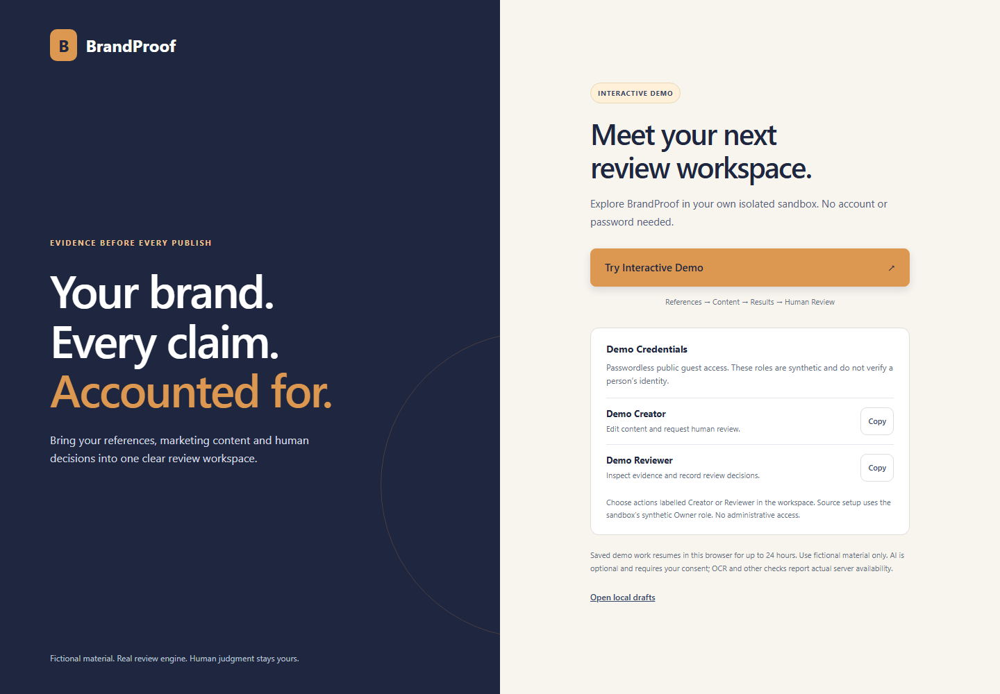
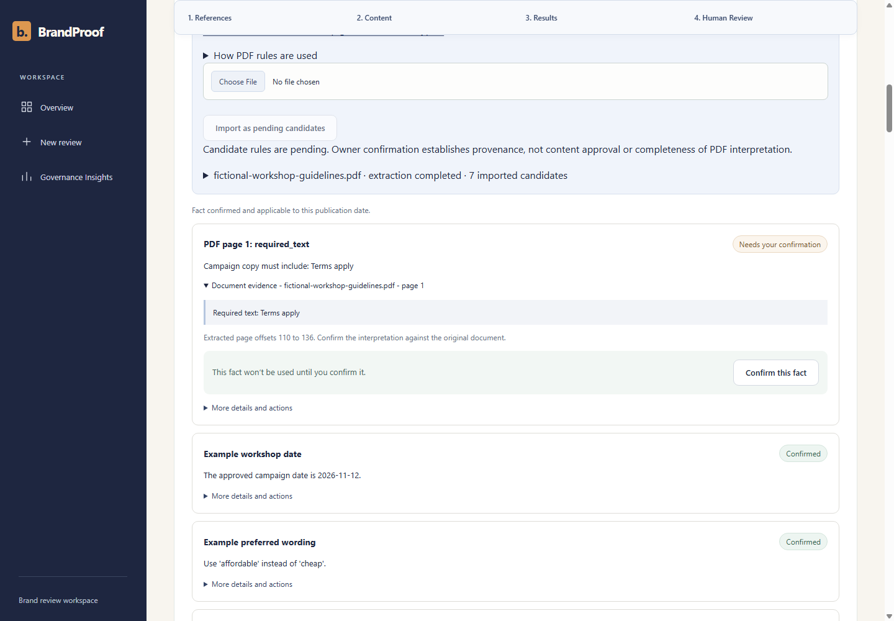
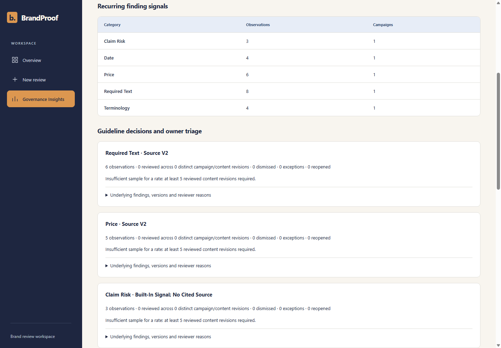
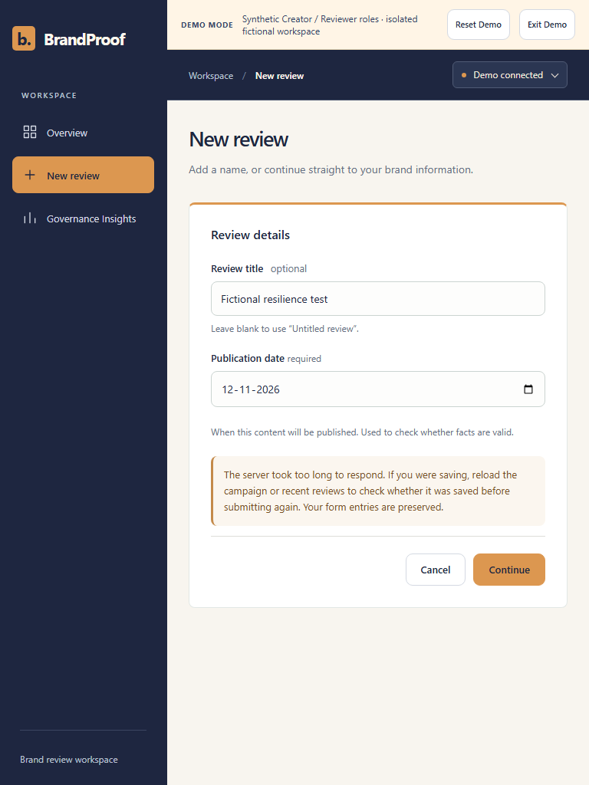

# BrandProof

**Evidence before every publish.** Team YOGI2KANWAR - Codex 48, Round 3. Final acceptance: 2 November 2026.

BrandProof helps a campaign team check marketing copy and posters against confirmed brand references, inspect why a finding was raised, and record an accountable human decision. It keeps content, guideline versions, automated coverage and human approval connected in one review workspace.

## Exactly three promised improvements

**1. PDF guideline import with traceable evidence.** Import supported directives, inspect exact page quotations, then explicitly confirm versioned rules.

**2. Measured visual consistency and accessibility.** Inspect supported background colour, contrast and poster-description checks, with measurements and honest uncertainty.

**3. Governance Insights.** Investigate recurring findings, exact guideline versions and reviewer reasons using persisted evidence and minimum sample requirements.

The existing OCR, human-review and bounded advertising-risk capabilities support these three improvements. They are not additional Round 3 promises.

**Judge demo:** [brand-proof-tau.vercel.app/#/demo](https://brand-proof-tau.vercel.app/#/demo)

**Repository:** [github.com/YogitaKanwar/BrandProof](https://github.com/YogitaKanwar/BrandProof)

<!-- page -->

# 1. Traceable PDF guidelines

Owners import text-layer PDFs up to 5 MiB / 30 pages. A bounded pypdf worker extracts supported directive candidates with page number, exact quotation/offsets and document SHA-256. Candidates are pending; no unconfirmed rule is authoritative evidence.

Explicit synthetic Owner confirmation creates approved v2 from pending v1 while preserving the original page evidence. Immutable source history and saved review snapshots retain provenance. Editing a rule clears its old citation when the wording changes, preventing a corrected rule from misleadingly inheriting an unsupported quote.

## What the real workflow demonstrates

The compact Workshop PDF produces three candidates; the extended sample produces seven rule types. Both specify INR 899. A real review of sample marketing content at INR 599 produces a source-version-cited contradiction. Correcting supported caption facts does not approve content or fix an unchanged poster.

## Robustness and limits

Tests exercise both shipped files, two supported pages, mixed supported/blank pages, actual raster-only and blank PDFs, encryption/corruption, wrong type, byte/page limits, extraction timeout, repeated imports, wrong roles, stale revisions and changed-rule provenance. Reimports create separate pending candidates; conflicting approved rules require clarification. Scans and unsupported narrative rules need manual transcription. Import does not authenticate document ownership.

<!-- page -->

# 2. Measured checks, stated scope

A reliable flat-background sample exposes the observed hex colour, approved target, CIE76 deviation and source tolerance. Supported OCR-word samples expose measured foreground/background, contrast ratio and the strictest confirmed threshold. Findings cite the relevant confirmed source.

Description checks assess presence and literal high-confidence OCR price/date coverage. Saving a description creates a content revision and can stale a prior approval. Description presence is not a semantic-quality verdict.

## Measured acceptance

Real rendered/OCR white-black and white-grey fixtures, approved/mismatched backgrounds, exact contrast thresholds, ordinary antialiasing, uncertainty, missing/whitespace descriptions, permissions and stale receipts passed. The combined public browser workflow passed actual measured checks and description handling.

Gradients, photographs, mixed ink, noisy or small/rotated text and incomplete OCR may be partial or unassessed. At most 100 OCR words are sampled. Eighteen optional Linux-path font-matrix cases were skipped on Windows; required Noto Sans fixture tests ran. No universal visual conformity, typography verification or full WCAG certification is claimed.

The candidate fixes a reproduced description-loading race after poster replacement. On the older public build, load the saved description before typing; public measurement acceptance uses that recovery action. The candidate passes replacement/edit/save without it.

<!-- page -->

# 3. Governance from saved evidence

Insights show recurring categories, campaign counts, exact confirmed source-version groups, latest reviewer dispositions/reasons and links to the underlying saved findings. Deleted campaigns remain hidden and workspaces stay isolated.

## Minimum sample and denominator

A group needs at least five reviewed observations and five distinct reviewed campaign/content revisions before a rate is shown. The rate is dismissals plus exceptions divided by all reviewed observations, including reopened decisions. Identical content/source/pack reruns contribute the latest snapshot and do not inherit previous-run decisions.

## Verified boundaries

API tests passed zero, one, four, exactly five and six reviewed snapshots, missing-reason rejection, updated/reopened decisions, multiple campaigns/source versions, reruns, run/decision truncation and isolation. Browser acceptance followed an insight into the exact historical run/finding and recovered it after refresh.

The bounded result covers at most 500 runs and 5,000 decisions, with at most 50 evidence links per group and explicit truncation. Signals invite inspection of reasons, not proof a guideline is wrong. Regulatory groups never recommend weakening an obligation because findings were dismissed. All demonstrated decisions are synthetic QA, not real customer analytics.

<!-- page -->

# Verification and user handling

**Final local backend:** 594 collected; **576 passed, 18 optional font skips, zero failures**. **Frontend:** **62 passed, zero failures/skips**; lint, TypeScript/Vite build and backend/scripts Ruff checks passed. No code coverage percentage or representative OCR/model accuracy was measured.

**Real HTTP:** nine frontend suites passed for sessions/campaigns, sources, reviews, posters, collaboration, approval, consent, removal/restore and both PDFs. Four Python workflow scripts passed; parser smoke verified ten readback cases, and real Tesseract workflow verified a reasoned scripted approval becoming stale after poster edit.

**Genuine Chromium:** three local suites passed (judge, combined improvements, fault injection). Two public suites passed (judge and combined improvements), plus both-file public PDF HTTP acceptance. Fresh contexts exercised roles/isolation, actual OCR boxes, human decisions, PDF confirmation, Insights links, refresh, reset/logout and removal/Undo. Desktop 1440px, tablet 768px and narrow 390/320px layouts were exercised.

**Failure injection:** a 503 and an actual ten-second transport timeout preserved the draft and restored controls. Duplicate activation sent one real create request. Wrong/empty/oversized/corrupt PDFs failed clearly, then a valid retry created only pending rules. New error-message regressions prevent PDF failures from prescribing image-only remedies.

Actual local process restart preserved ten compared resources, the recovery workspace, credentials and all role access. Clean isolated Windows setup installed locked dependencies, passed frontend lint/62 tests/build, read-only migration preflight and restart persistence. Linux instructions follow the existing Docker/CI path; they were not executed on this host.

<!-- page -->

# Release, limits and contributions

## Current public release and candidate

Vercel and Render independently reported **e01f52b6ee02b6c85c480619cfc82cc486a56123**. Latest fetched main **d251daa** includes PRs 12/13 and matches that application baseline. Final frontend error hardening, tests and documentation are a separate local candidate; no production deployment, migration or main publication was performed.

Public startup initially returned a proxy 502; direct Render database health recovered in about 22 seconds. The initial browser harness stopped at 45 seconds, shorter than the app's documented 90-second readiness. The harness now allows that initial window; unchanged assertions and the warmed public judge/PDF/combined journeys passed. Both attempts are retained. This is not a guarantee of idle cold-start latency.

Deployed-source GitHub container/PostgreSQL/legacy-upgrade and frontend workflows passed. No Docker/PostgreSQL executables are available on this Windows host; fresh final-candidate container CI remains a release gate. There is no new backend product/schema change. Production changes require explicit approval of a tested commit and reviewed recovery plan.

## Remaining limits

Text-layer/directive PDFs only; limited reliable image samples; OCR omissions/logo timeouts; bounded English claims/India legal scope; external contextual AI unavailable. Synthetic actors are not verified identities or independent sign-off. No full WCAG/brand/legal certification, production backup/restore audit, permanent free retention or representative accuracy is claimed. Earlier evidence reports database expiry 27 November 2026; verify current hosting retention separately.

## Technology and actual ownership

React 19, TypeScript, Vite; Python, FastAPI, Pydantic, SQLAlchemy, PostgreSQL/SQLite, pypdf, Pillow and Tesseract; Vercel proxy and Render Docker. Optional external AI remains server-configured and consent-gated.

Team-supplied roles: **Yogita Kanwar - frontend and integration. Rushab Ramhari Patil - backend, OCR, AI and database.** Significant implementation/testing used coding-assistant support. No invented hours, percentages or independent user feedback.

Reproduce using README.md. Exact commands, artifacts, skipped tests and release blockers: docs/ROUND3_FINAL_QA.md. Scope-by-case: docs/ROUND3_REQUIREMENTS_MATRIX.md. User path: docs/JUDGE_FINAL_WALKTHROUGH.md. Disclosure: docs/ROUND3_KNOWN_LIMITATIONS.md. This PDF is generated from docs/ROUND3_SUBMISSION_CONTENT.md. Official submission remains the team's action.
